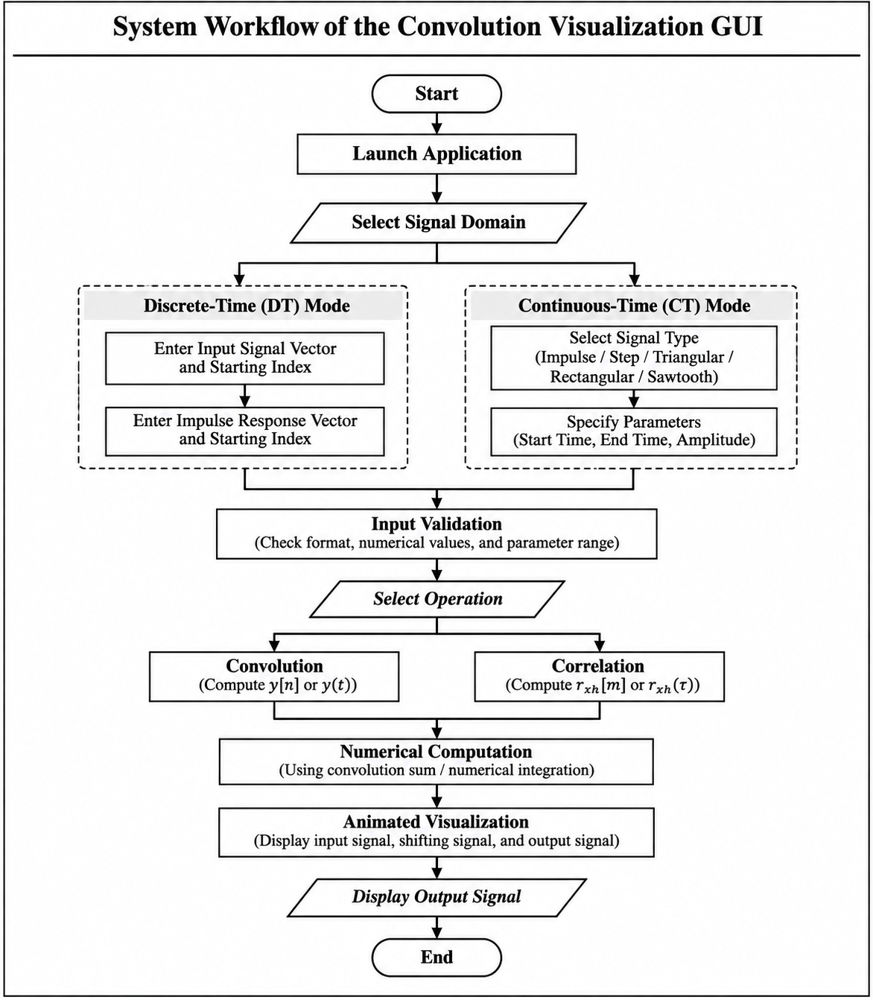
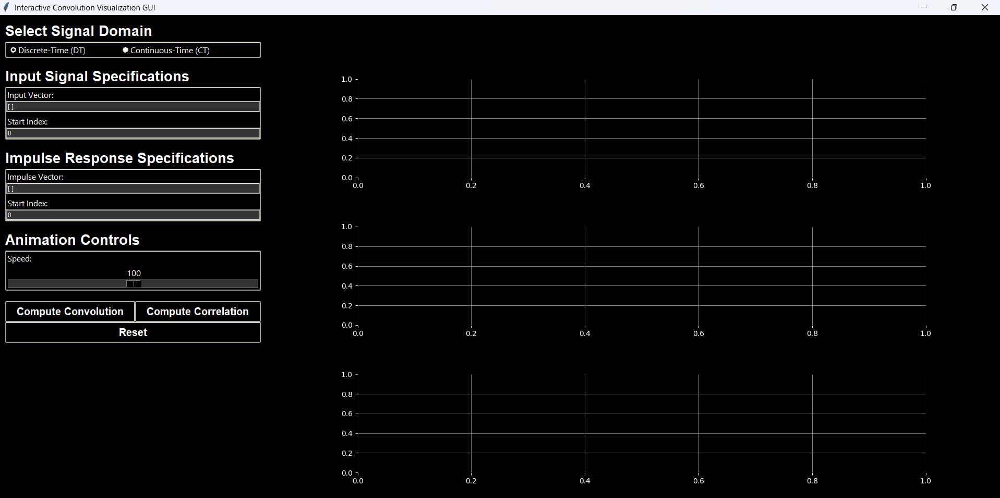
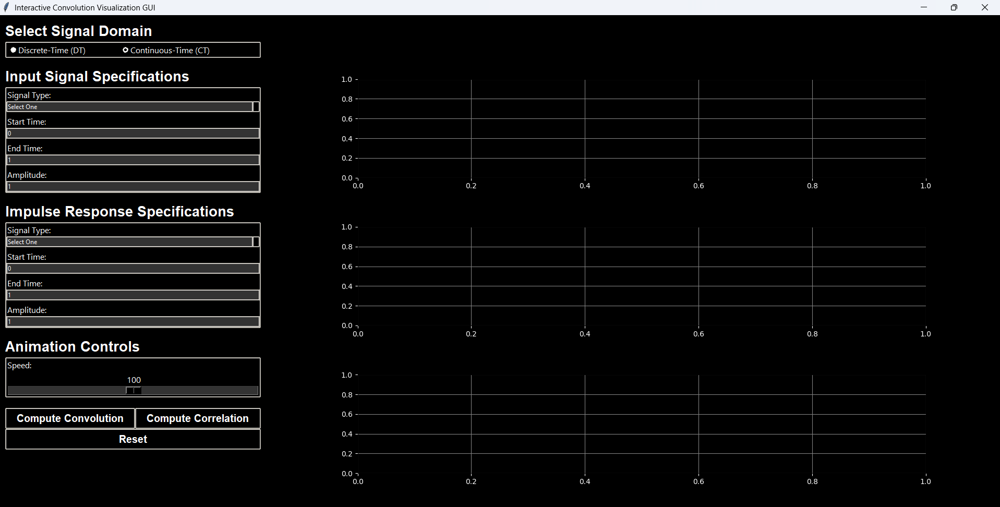
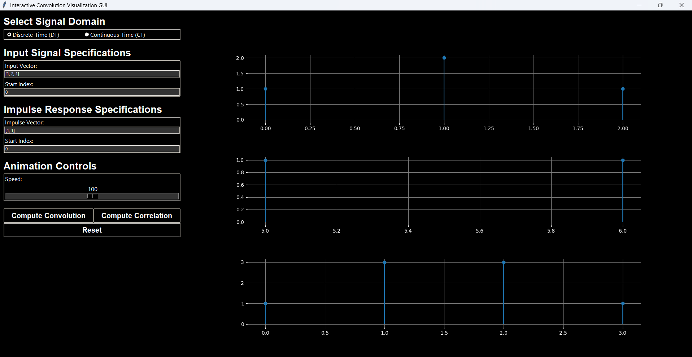
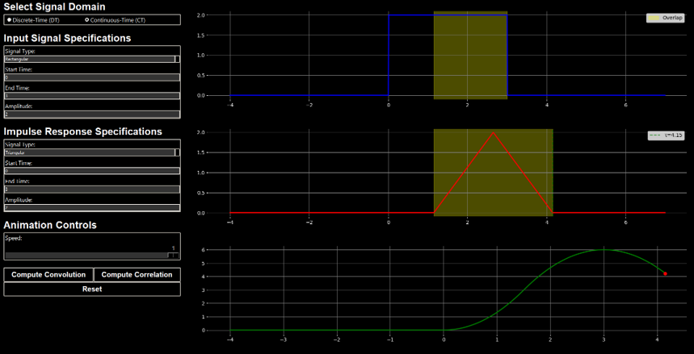
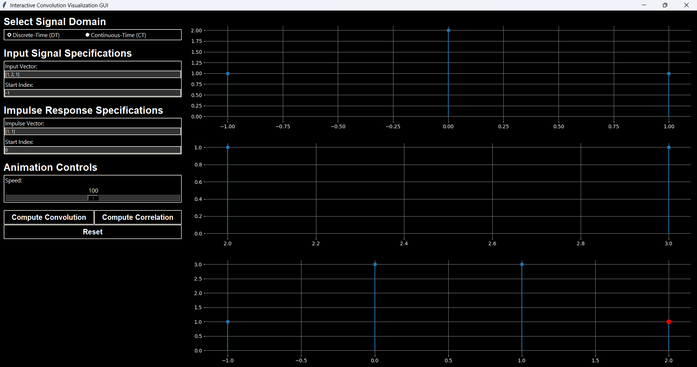
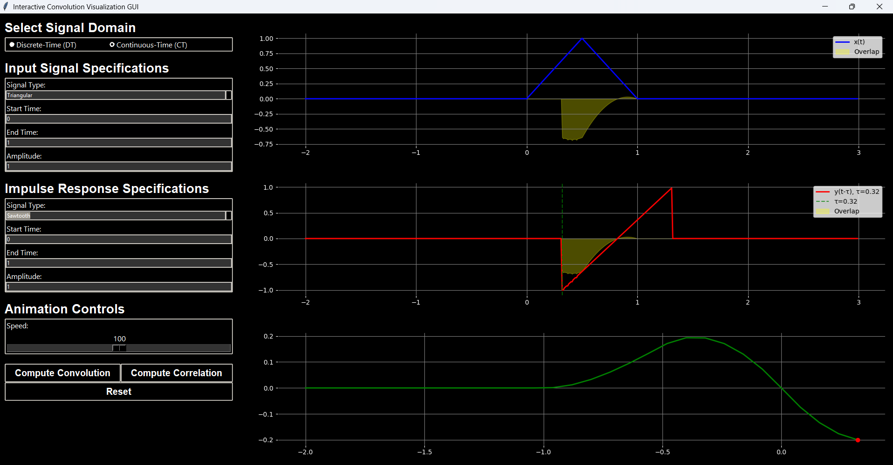

# Interactive Convolution Visualization GUI

An interactive Python-based graphical user interface (GUI) for visualizing **discrete-time and continuous-time convolution and correlation** through numerical computation, animated signal transformations, and real-time graphical representation.

The application demonstrates how convolution and correlation are constructed by visualizing the input signal, the shifting impulse response or second signal, and the progressively generated output.

---

## 1. Project Overview

Convolution is a fundamental mathematical operation in Signals and Systems, widely used in signal processing, filtering, system analysis, and image processing. Although convolution can be expressed mathematically, understanding the underlying operations of signal reversal, shifting, overlapping, and integration or summation can be challenging.

This project develops an interactive visualization tool that demonstrates these operations dynamically rather than presenting only the final computed result.

The application supports two signal domains:

- **Discrete-Time (DT):** Users enter numerical signal vectors and their corresponding starting indices.
- **Continuous-Time (CT):** Users select predefined signal types and configure their amplitudes and time intervals.

The GUI provides synchronized graphical representations of the input signal, the moving signal, and the evolving output.

In addition to convolution, the application implements **discrete-time and continuous-time cross-correlation**, along with adjustable animation speed, input validation, and reset functionality.

The project was developed using Python, Tkinter, NumPy, and Matplotlib as part of the EEE 4602 – Signals and Systems Lab course at the Islamic University of Technology (IUT).

## 2. Project Objectives

The primary objectives of this project were to:

- Develop an interactive GUI for visualizing convolution operations.
- Support both discrete-time and continuous-time signal domains.
- Allow users to configure input signals and impulse responses.
- Implement numerical convolution computation for both signal domains.
- Visualize signal reversal, shifting, and overlap during convolution.
- Display the progressive construction of the convolution output.
- Implement correlation computation and visualization as an additional feature.
- Provide adjustable animation speed and reset functionality.
- Integrate signal-processing computations with a responsive graphical interface.

## 3. Mathematical Background

### 3.1 Discrete-Time Convolution

For two discrete-time signals $x[n]$ and $h[n]$, convolution is defined as:

$$
y[n] = \sum_{k=-\infty}^{\infty} x[k]h[n-k]
$$

where:

- $x[n]$ represents the input signal.
- $h[n]$ represents the impulse response.
- $y[n]$ represents the convolution output.
- $n$ represents the discrete-time index.
- $k$ is the summation index.

The convolution process involves:

1. **Time Reversal:** Reverse the impulse response to obtain $h[-k]$.
2. **Shifting:** Shift the reversed signal to obtain $h[n-k]$.
3. **Multiplication:** Multiply the overlapping samples of $x[k]$ and $h[n-k]$.
4. **Summation:** Sum the products to obtain the output at the current index.

Repeating this process across the output indices produces the complete discrete-time convolution sequence.

### 3.2 Continuous-Time Convolution

For continuous-time signals $x(t)$ and $h(t)$, convolution is defined as:

$$
y(t) = \int_{-\infty}^{\infty} x(\tau)h(t-\tau)\,d\tau
$$

where:

- $x(t)$ represents the continuous-time input signal.
- $h(t)$ represents the impulse response.
- $y(t)$ represents the convolution output.
- $\tau$ is the integration variable.

The continuous-time convolution process follows the same fundamental sequence:

1. Reverse the impulse response.
2. Shift the reversed impulse response along the time axis.
3. Identify the overlapping region between the signals.
4. Multiply the signals within the overlap.
5. Integrate the product to obtain the output at the current time.

The GUI visualizes these operations through animated signal movement and progressive output plotting.

## 4. System Workflow

The application follows a structured workflow for performing discrete-time and continuous-time convolution and correlation operations.



The workflow begins with the selection of the signal domain, followed by the configuration and validation of the input signals.

For **discrete-time operations**, users specify the input signal vectors and their corresponding starting indices. For **continuous-time operations**, users select predefined signal types and configure their time intervals and amplitudes.

After input validation, the user selects either convolution or correlation. The application performs the corresponding numerical computation and generates an animated visualization showing the input signal, the shifting signal, and the progressively constructed output.

This workflow integrates signal configuration, numerical computation, and graphical visualization within a single interactive application.

## 5. GUI Design and Interface

The graphical interface was developed using **Tkinter**, with Matplotlib embedded to display the signal plots.

The interface uses a dark-themed layout and is divided into two primary areas:

- **Control Panel:** Contains signal-domain selection, signal inputs, operation buttons, animation-speed control, and reset functionality.
- **Visualization Panel:** Displays the input signal, shifting signal, and evolving output through three graphical plots.

The application provides radio buttons, dropdown menus, numerical input fields, control buttons, and a speed-adjustment slider.

### 5.1 Discrete-Time Interface

The discrete-time interface allows users to enter numerical signal vectors and specify their starting indices.



### 5.2 Continuous-Time Interface

The continuous-time interface provides predefined signal types and configurable time-domain parameters.



## 6. Signal Modes and Input Configuration

### 6.1 Discrete-Time Mode

In discrete-time mode, users manually specify:

- Input signal vector
- Input signal starting index
- Impulse response vector
- Impulse response starting index

For example:

```text
Input Signal:
x[n] = [1, 2, 1]
Starting Index = 0

Impulse Response:
h[n] = [1, 1]
Starting Index = 0
```

For this example, the convolution result is:

$$
y[n] = [1,3,3,1]
$$

with the output starting index determined by the sum of the two input starting indices.

The application uses the supplied vectors and indices to construct the corresponding discrete-time representations and perform convolution.

### 6.2 Continuous-Time Mode

In continuous-time mode, users select predefined signal types for both the input signal and impulse response.

Supported signal types include:

| Signal Type | Description |
|---|---|
| Impulse | Impulse-like signal representation |
| Step | Signal representing a step transition |
| Triangular | Triangular-shaped signal |
| Rectangular | Constant-amplitude pulse over a defined interval |
| Sawtooth | Linearly varying sawtooth-shaped signal |

Users can configure:

- Signal type
- Starting time
- Ending time
- Amplitude

These parameters are used to generate sampled representations of the selected continuous-time signals for numerical computation and visualization.

## 7. Convolution Computation

### 7.1 Discrete-Time Convolution

Discrete-time convolution is computed using NumPy's built-in convolution function:

```python
np.convolve(input_signal, impulse_response)
```

The function calculates the linear convolution of the supplied signal vectors.

The application also accounts for the starting indices of the input signals to determine the corresponding output-index range.

### 7.2 Continuous-Time Convolution

Continuous-time convolution is evaluated numerically using sampled signal representations.

The implementation follows the continuous convolution integral:

$$
y(t) = \int_{-\infty}^{\infty} x(\tau)h(t-\tau)\,d\tau
$$

For each evaluation time, the shifted impulse response is generated, multiplied by the input signal, and numerically integrated.

The implementation uses the trapezoidal integration approach through NumPy:

```python
np.trapz(product, time_axis)
```

where `product` represents the pointwise multiplication of the input signal and shifted impulse response.

During development, an initial approach using a built-in convolution function produced difficulties in aligning the output with the intended time axis. The implementation was therefore revised to evaluate the continuous convolution expression numerically, allowing the computation and visualization to follow the same time-domain representation.

## 8. Interactive Convolution Animation

A central feature of the application is its animated visualization of the convolution process.

Rather than displaying only the completed output, the application progressively demonstrates the transformations involved in convolution.

The visualization panel contains three synchronized plots:

| Plot | Function |
|---|---|
| Input Signal | Displays the stationary input signal |
| Shifted Impulse Response | Displays the reversed and shifting impulse response |
| Convolution Output | Displays the progressively constructed output signal |

### 8.1 Discrete-Time Convolution Animation

The discrete-time animation demonstrates the movement of the reversed impulse response across the input sequence.

At each animation step, the application updates the shifting signal and the corresponding convolution output.



### 8.2 Continuous-Time Convolution Animation

The continuous-time animation demonstrates the movement of the reversed impulse response along the time axis.

The visualization highlights signal overlap and displays the evolving convolution result as the relative shift changes.



The continuous-time visualization provides a graphical interpretation of the multiplication and integration operations underlying convolution.

## 9. Correlation Analysis

In addition to convolution, the application implements **cross-correlation computation and animation** for both discrete-time and continuous-time signals.

Correlation measures the similarity between two signals as a function of their relative displacement.

### 9.1 Discrete-Time Cross-Correlation

For real-valued discrete-time signals, cross-correlation can be expressed as:

$$
r_{xh}[m] = \sum_{n=-\infty}^{\infty} x[n]h[n-m]
$$

where $m$ represents the relative lag between the signals.

The implementation uses NumPy's correlation functionality:

```python
np.correlate(signal1, signal2, mode="full")
```

The resulting correlation sequence is displayed through an animated visualization.

### 9.2 Continuous-Time Cross-Correlation

For real-valued continuous-time signals, cross-correlation can be expressed as:

$$
r_{xh}(\tau) = \int_{-\infty}^{\infty} x(t)h(t-\tau)\,dt
$$

where $\tau$ represents the relative time lag.

The application numerically evaluates the correlation between the sampled continuous-time signals and visualizes the result as their relative displacement changes.

### 9.3 Correlation Visualization

The correlation feature was implemented as an additional functionality beyond the primary convolution requirements.

It allows users to observe how signal alignment influences the resulting correlation output.

**Discrete-Time Correlation**



**Continuous-Time Correlation**



## 10. Input Validation and Interactive Controls

The application includes several controls to improve usability and support interactive experimentation.

### 10.1 Input Validation

The input-validation functionality checks user-provided signal information before computation.

Validation includes checks for:

- Appropriate numerical input formats
- Valid signal vectors and indices
- Required signal parameters
- Valid time ranges and amplitudes

Warning messages are displayed when invalid inputs or conflicting operations are detected.

### 10.2 Animation Speed Control

An adjustable slider allows users to control the animation speed.

This enables slower observation of individual convolution or correlation steps or faster visualization of the overall operation.

### 10.3 Reset Functionality

The Reset control allows users to:

- Stop the current animation
- Clear the displayed plots
- Restore the interface to its initial state
- Enter new signal configurations

### 10.4 Animation Execution

The implementation uses Python's `threading` module to manage animation execution separately from the main application flow.

This approach was introduced to reduce interface blocking during animated computations.

## 11. Results and Visualization

The completed application demonstrates convolution and correlation through interactive graphical representations.

The main results include:

- Visualization of discrete-time convolution
- Visualization of continuous-time convolution
- Progressive construction of convolution outputs
- Animated shifting and overlap of signals
- Discrete-time cross-correlation visualization
- Continuous-time cross-correlation visualization
- Interactive GUI controls for configuring and observing signal-processing operations

The screenshots included in this repository document the GUI and selected states of the convolution and correlation animations.

### 11.1 GUI Screenshots

| Mode | Screenshot |
|---|---|
| Discrete-Time Interface | [View Screenshot](results/figures/gui/discrete_mode.png) |
| Continuous-Time Interface | [View Screenshot](results/figures/gui/continuous_mode.png) |

### 11.2 Convolution Screenshots

| Operation | Screenshot |
|---|---|
| Discrete-Time Convolution | [View Screenshot](results/figures/convolution/discrete_convolution.png) |
| Continuous-Time Convolution | [View Screenshot](results/figures/convolution/continuous_convolution.png) |

### 11.3 Correlation Screenshots

| Operation | Screenshot |
|---|---|
| Discrete-Time Correlation | [View Screenshot](results/figures/correlation/discrete_correlation.png) |
| Continuous-Time Correlation | [View Screenshot](results/figures/correlation/continuous_correlation.png) |

### 11.4 Video Demonstrations

The following MP4 demonstrations showcase the application's interactive visualization capabilities.

These recordings provide a clearer representation of the animation process than static screenshots, particularly the movement of the shifted signals and the progressive construction of the output.

| Demonstration | Description | Video |
|---|---|---|
| **Discrete-Time Convolution** | Demonstrates the shifting and overlapping of discrete signals and the progressive construction of the convolution output. | [Watch Demo](results/videos/discrete_convolution_demo.mp4) |
| **Continuous-Time Convolution** | Visualizes the reversed and shifted impulse response, signal overlap, and the evolving continuous-time convolution output. | [Watch Demo](results/videos/continuous_convolution_demo.mp4) |
| **Continuous-Time Correlation** | Demonstrates the relative shifting of continuous-time signals and the animated construction of the cross-correlation output. | [Watch Demo](results/videos/continuous_correlation_demo.mp4) |

The demonstration videos are provided in MP4 format to preserve animation quality and provide a smoother representation of the application's behavior.

## 12. Technologies Used

### Programming Language

- Python

### Libraries and Frameworks

| Technology | Application |
|---|---|
| NumPy | Numerical operations, convolution, correlation, and signal arrays |
| Matplotlib | Signal plotting, graphical visualization, and animation |
| Tkinter | GUI development and interactive controls |
| threading | Background animation execution |

### Engineering and Computational Concepts

- Signals and Systems
- Discrete-Time Convolution
- Continuous-Time Convolution
- Cross-Correlation
- Signal Reversal and Shifting
- Signal Overlap and Superposition
- Numerical Integration
- Numerical Signal Processing
- Interactive Data Visualization
- GUI Development
- Input Validation

## 13. Installation

### 13.1 Prerequisites

The application requires:

- Python 3.9 or later (recommended)
- NumPy
- Matplotlib
- Tkinter support
- A desktop environment capable of displaying graphical applications

Tkinter is included with many standard Python installations, although some operating systems require it to be installed separately.

### 13.2 Clone the Repository

Open a terminal and run:

```bash
git clone https://github.com/mashrursaademad/interactive-convolution-visualization-gui.git
```

Navigate to the project directory:

```bash
cd interactive-convolution-visualization-gui
```

### 13.3 Install Dependencies

Install the required Python libraries:

```bash
python -m pip install -r requirements.txt
```

The `requirements.txt` file contains:

```text
numpy
matplotlib
```

## 14. How to Run

After installing the dependencies, launch the application using:

```bash
python src/convolution_visualizer.py
```

The GUI window will open, allowing users to select the signal domain and configure the input signals.

### 14.1 Running Discrete-Time Convolution

1. Select **Discrete-Time** mode.
2. Enter the input signal vector and starting index.
3. Enter the impulse response vector and starting index.
4. Adjust the animation speed if required.
5. Click **Compute Convolution**.
6. Observe the shifting impulse response and progressively generated convolution output.

### 14.2 Running Continuous-Time Convolution

1. Select **Continuous-Time** mode.
2. Choose the input signal type.
3. Specify the input signal's starting time, ending time, and amplitude.
4. Configure the impulse response using the same parameters.
5. Adjust the animation speed if required.
6. Click **Compute Convolution**.
7. Observe the shifting impulse response, signal overlap, and resulting output.

### 14.3 Running Correlation

To visualize correlation:

1. Select the desired signal domain.
2. Configure the two signals.
3. Click **Compute Correlation**.
4. Observe the animated correlation process and resulting output.

Use **Reset** to clear the current configuration and begin a new experiment.

## 15. Project Structure

```text
interactive-convolution-visualization-gui/
│
├── README.md
├── requirements.txt
├── .gitignore
│
├── src/
│   └── convolution_visualizer.py
│
├── documentation/
│   ├── EEE4602_Project_Report.pdf
│   └── Project_Manual.pdf
│
└── results/
    ├── architecture/
    │   └── system_workflow.png
    │
    ├── figures/
    │   ├── gui/
    │   │   ├── discrete_mode.png
    │   │   └── continuous_mode.png
    │   │
    │   ├── convolution/
    │   │   ├── discrete_convolution.png
    │   │   └── continuous_convolution.png
    │   │
    │   └── correlation/
    │       ├── discrete_correlation.png
    │       └── continuous_correlation.png
    │
    └── videos/
        ├── discrete_convolution_demo.mp4
        ├── continuous_convolution_demo.mp4
        └── continuous_correlation_demo.mp4
```

## 16. Documentation

The repository includes the project report and the original project manual.

- [EEE 4602 Project Report (PDF)](documentation/EEE4602_Project_Report.pdf)
- [Project Manual (PDF)](documentation/Project_Manual.pdf)

The project report provides additional information regarding the methodology, interface design, numerical computation, animation development, teamwork, and project implementation.

The project manual describes the original assignment objectives, functional requirements, and expected application behavior.

## 17. Scope and Limitations

The application was developed as an educational tool for demonstrating convolution and correlation in Signals and Systems.

The following limitations should be considered:

- Continuous-time signals are represented through numerical sampling rather than symbolic mathematical expressions.
- Continuous-time convolution and correlation are evaluated numerically, so their accuracy depends on the selected sampling resolution and integration method.
- The available continuous-time signals are limited to the predefined signal types implemented in the application.
- Discrete-time inputs are provided as finite-length numerical vectors.
- The application is intended for educational visualization rather than high-performance or real-time signal-processing deployment.
- The GUI requires a compatible desktop Python environment.

Despite these limitations, the application provides an interactive representation of convolution and correlation that connects mathematical theory with numerical computation and graphical interpretation.

## 18. Contributors and Individual Contribution

### 18.1 Contributors

Developed as a group academic project for:

**Course:** EEE 4602 – Signals and Systems Lab  
**Institution:** Islamic University of Technology (IUT)
**Date of Submission:** 23 July 2025

**Team Members:**

- Mashrur Saad Emad
- Radiba Nuzhat
- Md. Shazid Hasan
- Bireer Ibrahim Elhag

### 18.2 My Contribution

My documented contributions across the project included:

- **Research and Analysis**: Problem analysis and investigation of convolution visualization approaches

- **GUI Development**: Interface design and visualization layout

- **Signal Processing Implementation**: Convolution computation

- **Visualization and Animation**: Development of convolution animation functionality

- **Documentation**: Project report preparation

The complete application was developed collaboratively by the project team, while the items above represent my documented contributions to the project.

## 19. Repository Maintainer

**Mashrur Saad Emad**  
Electrical and Electronic Engineering Graduate  
Islamic University of Technology (IUT)

[GitHub Profile](https://github.com/mashrursaademad)  
[LinkedIn Profile](https://www.linkedin.com/in/mashrur-saad-emad-787995436/)
